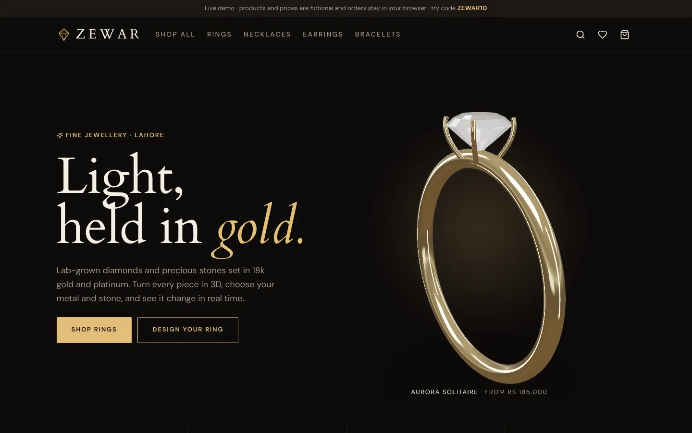
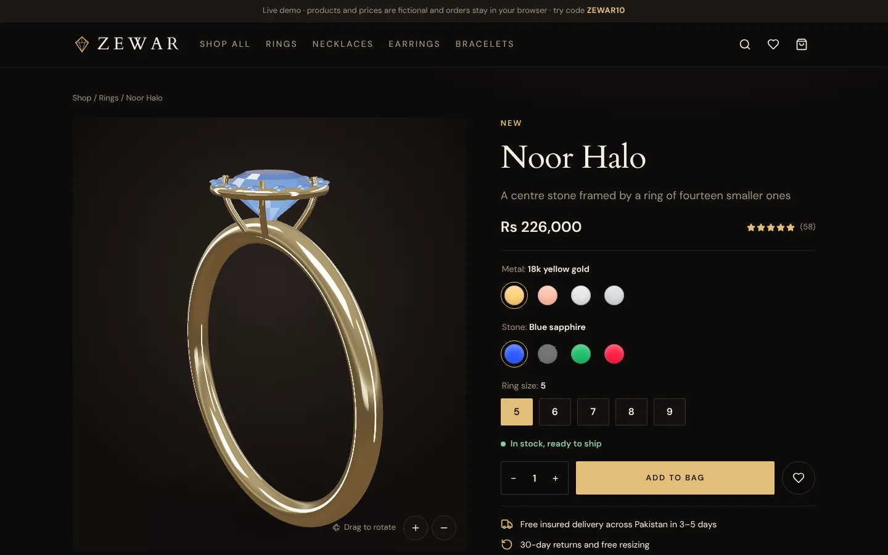
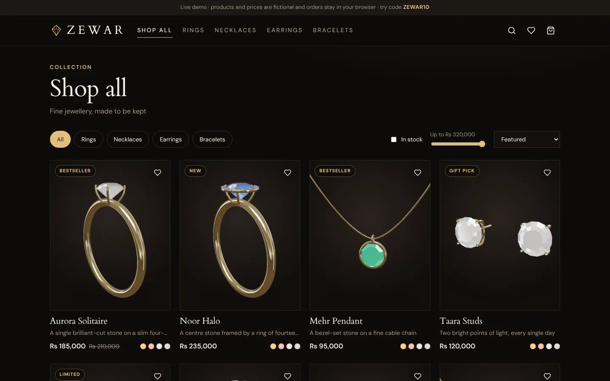
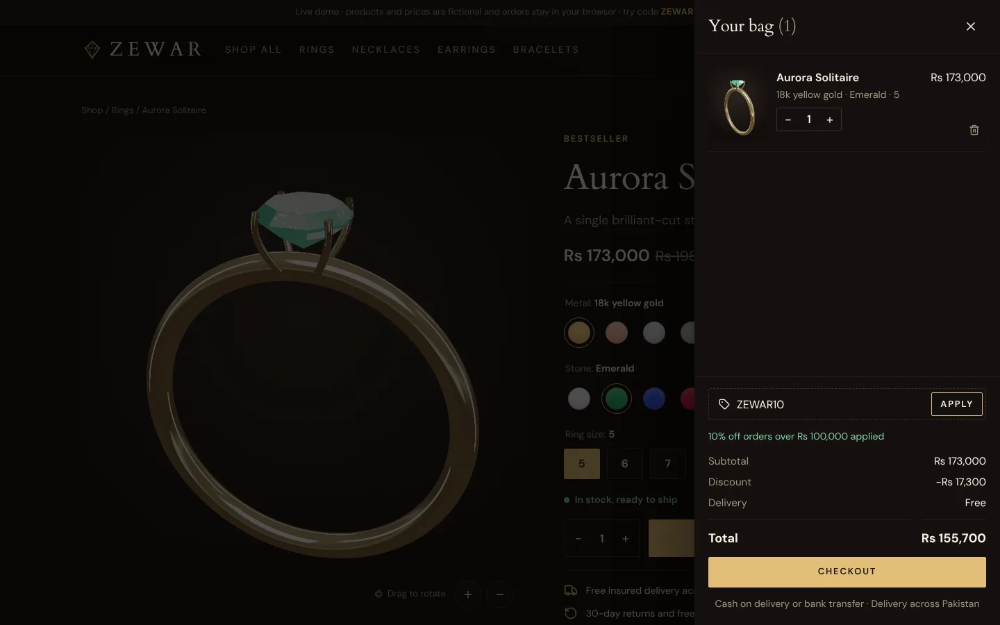
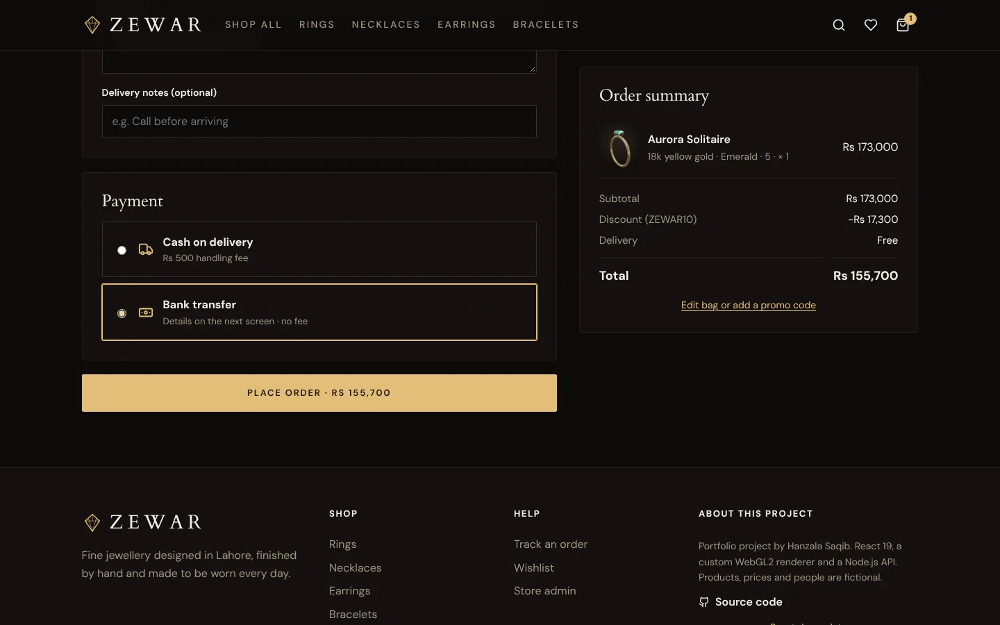
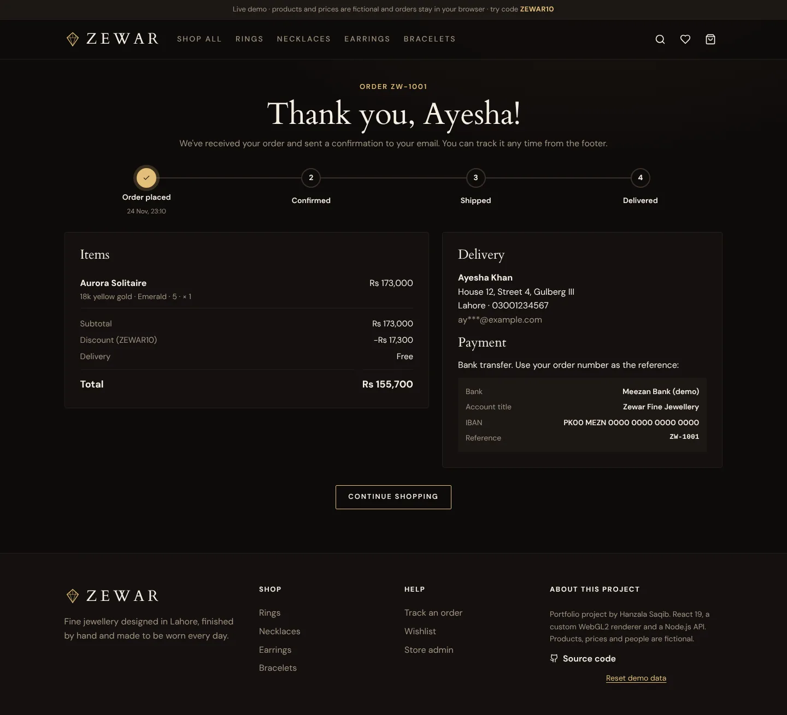
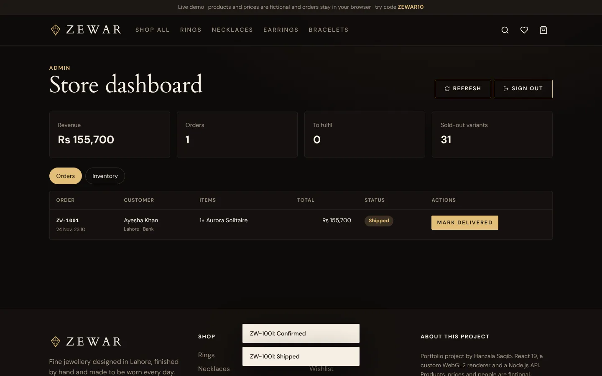
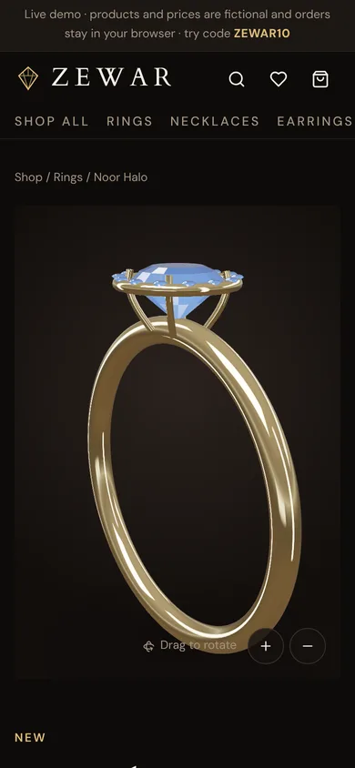
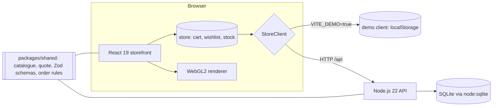

# Zewar — fine jewellery, in real-time 3D

[](https://github.com/hanzalasqb/zewar-jewellery/actions/workflows/ci.yml)
[](https://hanzalasqb.github.io/zewar-jewellery/)


A full-stack jewellery store where every ring, pendant and earring is rendered live in 3D. Pick 18k yellow, rose or white gold or platinum, swap a diamond for an emerald, sapphire or ruby, and watch the piece, the price and the stock update together. Then check out with cash on delivery and manage the order from an admin dashboard.

**Live demo:** [hanzalasqb.github.io/zewar-jewellery/](https://hanzalasqb.github.io/zewar-jewellery/) · [instant preview](https://claude.ai/artifact/MRh3bAxnV7yobBPy1PcXjh)
Try coupon **`ZEWAR10`**, check out, then open **Admin** (footer) to confirm and ship your order. Demo admin: `admin@demo.store` / `demo-admin`.

> The live demo runs entirely in your browser: orders, stock and the admin dashboard are stored in `localStorage`, so you can try the whole flow without a server. Run it locally to use the real Node.js API and SQLite database.



| Product in 3D | Shop | Bag |
| --- | --- | --- |
|  |  |  |
| **Checkout** | **Order tracking** | **Admin** |
|  |  |  |

<p align="center"></p>

## Features

**Storefront**
- Real-time 3D on every product: drag to orbit, pinch or buttons to zoom, arrow keys for keyboard users, auto-rotate that pauses while you interact.
- 12 pieces across rings, necklaces, earrings and bracelets: solitaire, halo, eternity band, pendants, studs, hoops, pearl drops and a tennis bracelet.
- Options: metal (4), stone (diamond, emerald, sapphire, ruby, pearl), ring size, chain length. Every combination is its own variant with its own price and stock, and the 3D model, price and stock badge update instantly.
- Product cards use live 3D thumbnails rendered once in the background and cached, so the grid stays fast.
- Shop with category filters, search, in-stock filter, price range and sorting.
- Bag drawer with free-delivery meter, coupon codes and a running total; wishlist; recently placed orders.
- Checkout with field-level validation (Pakistani mobile numbers, city list, address), cash on delivery or bank transfer.
- Order page with a status timeline, and order tracking by order number plus email.
- Responsive from 320px up, keyboard accessible, and it respects reduced-motion settings.

**Back office**
- Admin sign-in (JWT), revenue and fulfilment stats.
- Order workflow: placed → confirmed → shipped → delivered, or cancelled (which returns the stock).
- Inventory per variant, with one-click restock of sold-out variants.

**Built to be trusted**
- The server prices every order itself from the catalogue; prices sent by the browser are ignored.
- Stock is decremented inside a SQLite transaction with a guarded update, so two shoppers can't buy the last piece.
- The same `quote()` function prices the bag in the browser and the order on the server, so totals always match.
- Admin passwords are hashed with scrypt; order lookups need the order number and the email; checkout is rate-limited.

## The 3D engine

There is no three.js here. Zewar ships a small WebGL2 renderer written for this store (about 1,500 lines in [`apps/web/src/gl`](apps/web/src/gl)):

- **Metals**: an analytic photo-studio environment (softboxes and a warm horizon) gives gold and platinum real reflections without loading a single HDR file. Rose, yellow and white gold and platinum each have their own tint and roughness.
- **Gemstones**: brilliant and emerald cuts built facet by facet. The shader refracts each colour channel separately, so diamonds throw spectral fire, and adds facet flashes as the piece turns.
- **Pearls**: a soft lustre shader with orient (the faint rainbow sheen on a real pearl).
- **Geometry**: rings, prongs, halos, chains and hoops are generated in code (lathe, torus, tube and faceted-cut builders), so a new design is a few lines of data rather than a 3D model file.
- **Performance**: one canvas per visible stage, frames are drawn only while something moves, off-screen stages pause, and resolution drops automatically on slow GPUs and recovers on fast ones. Thumbnails come from one shared hidden viewer.
- **Fallbacks**: without WebGL2 the 3D stages show a short notice, and everything else (shop, bag, checkout, admin) keeps working.

## Architecture



| Part | What it does |
| --- | --- |
| `packages/shared` | Catalogue, options and variants, money in paisa, `quote()` pricing, coupons, shipping, `CheckoutSchema` (Zod), order statuses and allowed transitions. Used by both apps. |
| `apps/api` | Node.js 22 with no framework: a tiny router over `node:http`, `node:sqlite`, scrypt and HS256 JWT, a rate limiter and structured JSON logs. |
| `apps/web` | React 19 + Vite, hash routing (works on GitHub Pages), one external store with `useSyncExternalStore`, and the WebGL2 renderer. |
| `design/tokens.json` | W3C design tokens, the source of truth for colour, type, radius and shadow. |

## Tech stack

TypeScript everywhere · React 19 · Vite 6 · WebGL2 and GLSL ES 3.0 · Node.js 22 (`node:http`, `node:sqlite`, `node:test`) · Zod · react-icons · Docker and nginx · GitHub Actions and GitHub Pages.

## Design system and Figma

Warm black and ivory with a champagne-gold accent; Cardo for display type and DM Sans for text; small radii and hairline borders, like a jeweller's box.

All of it lives in [`design/tokens.json`](design/tokens.json) in the W3C Design Tokens format: primitives (palette, type scale) and semantic tokens (`color.bg`, `color.accent`, `radius.button` and so on).

- **In Figma**: open the Tokens Studio plugin, choose *Load from file* (or sync this repo), and the 46 tokens appear as Figma styles and variables.
- **In code**: `npm run tokens` turns the same file into CSS custom properties in `apps/web/src/styles/tokens.css`. CI fails if the two drift apart.

The storefront itself is shared with its sister store, so the brand layer is small: tokens, `brand.css`, the logo, the home page and the catalogue.

## Getting started

Needs Node.js 22.13 or newer.

```bash
git clone https://github.com/hanzalasqb/zewar-jewellery.git
cd zewar-jewellery
npm install
cp apps/api/.env.example apps/api/.env   # set JWT_SECRET, ADMIN_EMAIL, ADMIN_PASSWORD
npm run dev                              # API on :4000, storefront on :5173
```

Or try the browser-only demo with no API: `npm run dev:demo`.

| Script | |
| --- | --- |
| `npm run dev` | API and storefront with hot reload |
| `npm run dev:demo` | Storefront only, data in localStorage |
| `npm test` | API and pricing tests (`node:test`) |
| `npm run typecheck` | TypeScript, both apps |
| `npm run build` | Bundled API and static storefront |
| `npm run tokens` | Regenerate CSS variables from `design/tokens.json` |

### Environment

| Variable | |
| --- | --- |
| `JWT_SECRET` | Required, 32+ characters |
| `ADMIN_EMAIL` | Admin sign-in email |
| `ADMIN_PASSWORD_HASH` | scrypt hash for production (or `ADMIN_PASSWORD` locally, hashed at start-up) |
| `DATABASE_FILE` | SQLite file, default `store.db` |
| `CORS_ORIGINS` | Comma-separated allowed origins |
| `PORT` | Default `4000` |

## API

| Method | Path | |
| --- | --- | --- |
| GET | `/api/health` | Health check |
| GET | `/api/products` | Catalogue with stock per variant |
| GET | `/api/products/:slug` | One product |
| POST | `/api/cart/quote` | Price a bag (coupon, shipping, payment) |
| POST | `/api/orders` | Place an order (validated, priced and stock-checked on the server) |
| POST | `/api/orders/track` | Order by number and email |
| POST | `/api/admin/login` | Admin JWT |
| GET | `/api/admin/orders` | All orders |
| PATCH | `/api/admin/orders/:number` | Move an order along its workflow |
| GET | `/api/admin/inventory` | Stock for every variant |
| PATCH | `/api/admin/inventory/:productId` | Set stock |

## Tests

`npm test` runs 12 tests: variant pricing, line merging and quantity caps, coupon rules, the COD fee, checkout validation, server-side pricing that ignores client prices, overselling protection, order tracking, admin auth and workflow, and restocking on cancel. The whole shopping flow (3D option changes, drag to rotate, bag, coupon, checkout, admin, tracking, wishlist, search and mobile layout) was also exercised end to end in headless Chromium.

## Deploy

- **Live demo**: pushing to `main` builds the browser-only demo and publishes it to GitHub Pages (Settings → Pages → Source: GitHub Actions).
- **Full stack**: `JWT_SECRET=... ADMIN_EMAIL=... ADMIN_PASSWORD=... docker compose up --build`, then open http://localhost:8080. The SQLite file lives in a named volume.

## Project structure

```
apps/
  api/            Node.js API (src/app.ts, db.ts, auth.ts, http.ts) and tests
  web/src/
    gl/           WebGL2 renderer, shaders, geometry and jewellery builders
    three/        React <Stage> and the thumbnail service
    brand/        Zewar's home page, logo, copy and 3D model mapping
    pages/        Shop, Product, Checkout, Orders, Wishlist, Admin
    components/   Header, bag drawer, option picker, product card
    api/          HTTP client and the in-browser demo client
packages/shared/  Catalogue, pricing, checkout schema, order rules
design/           Design tokens (Figma / Tokens Studio)
```

## License

MIT © Hanzala Saqib. Products, prices, people and the brand are fictional; this is a portfolio project.
